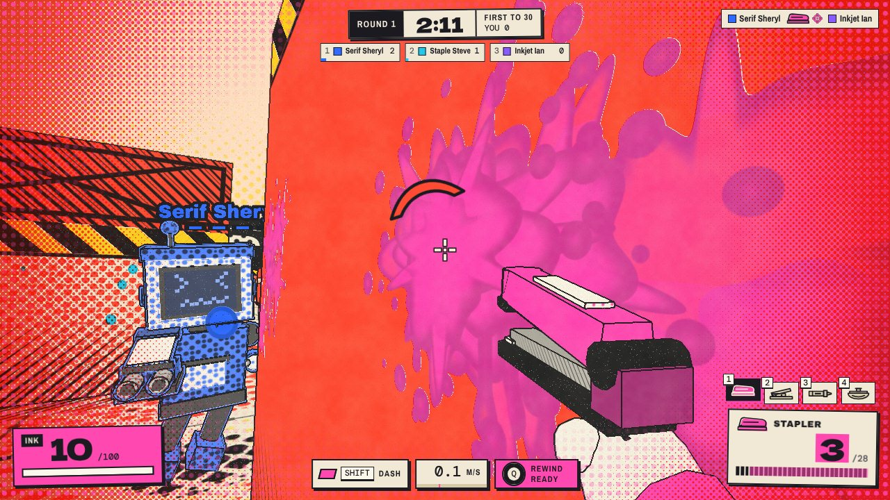
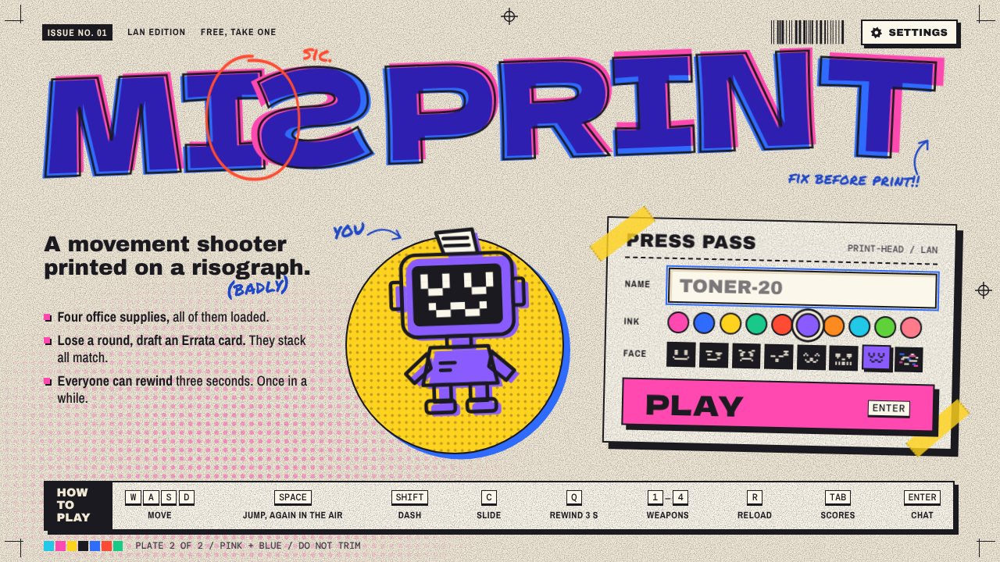
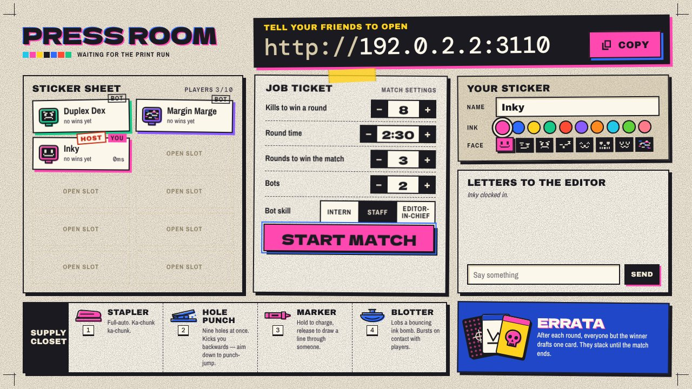
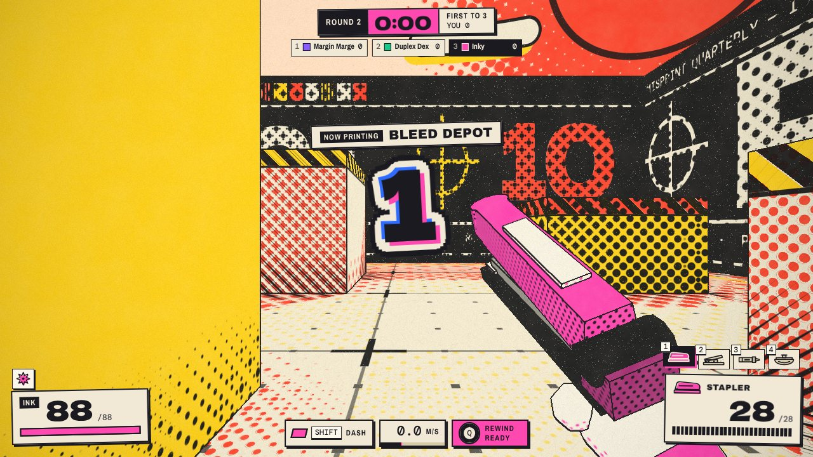
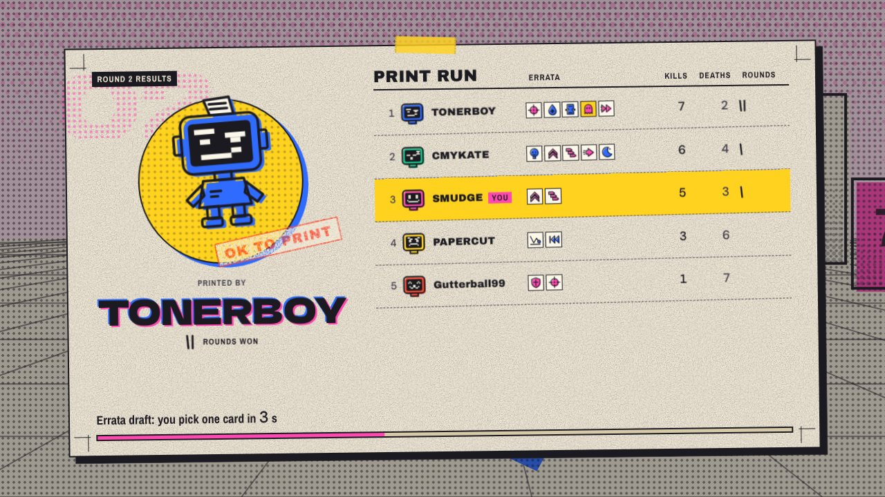
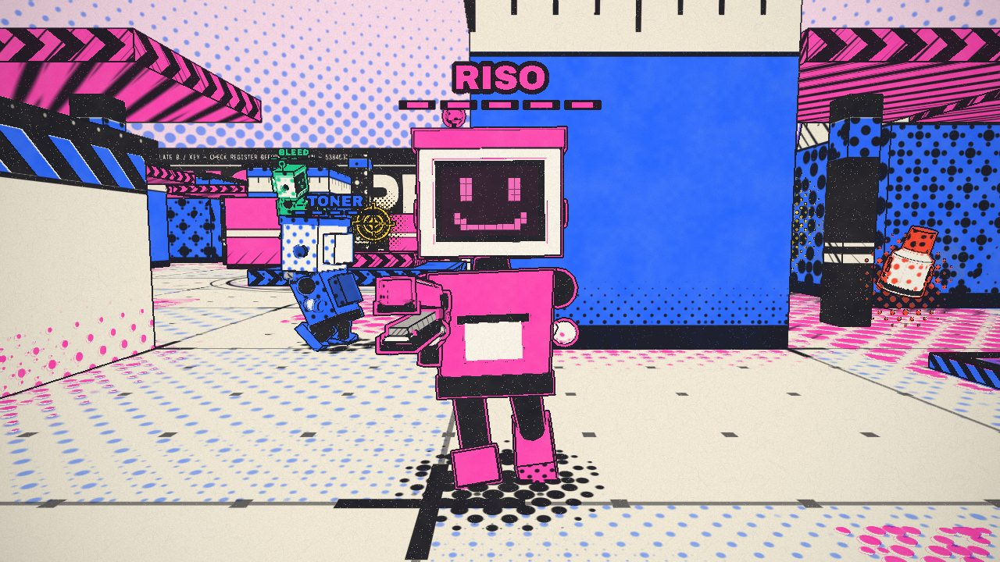
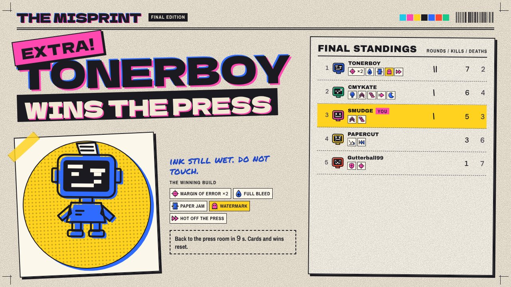
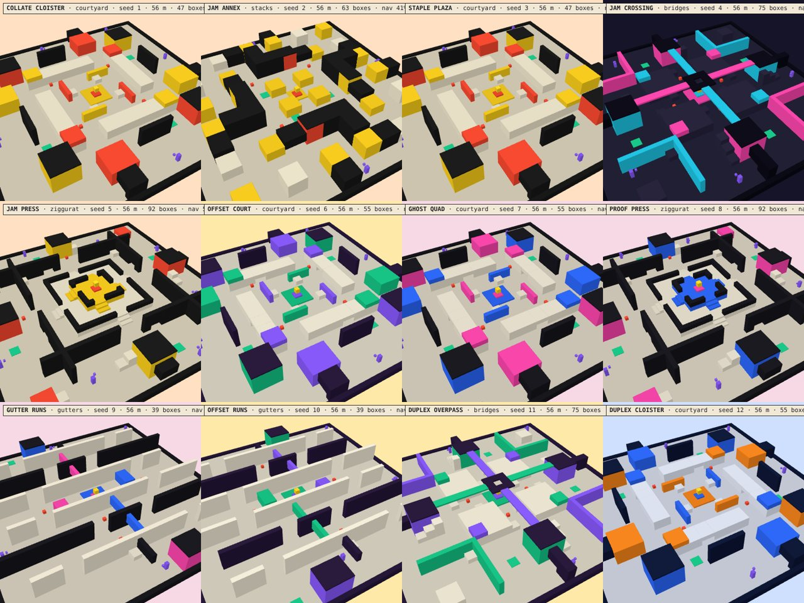

# MISPRINT

**A movement shooter printed on a risograph (badly).** Host it on your computer; friends join from a browser. No accounts, no downloads for them, no asset files at all.



- **Movement:** slide, double-jump, dash, wall-run, air-strafe, jump pads. The Hole Punch kicks you backwards, so aim it at the floor to punch-jump.
- **Rewind:** everyone can snap back three seconds, in position and health.
- **Errata cards:** after every round, everyone except the winner drafts one of three mutation cards. Builds stack for the whole match: 26 cards, from extra air jumps to ricocheting staples.
- **Ink:** every shot leaves a splat in the shooter's colour. By the end of a round the arena looks like a ruined print run.
- **Arenas:** a new one is generated from a seed every round, from five layouts.
- **Bots:** up to six, at three skill levels, so two friends still get a full match.
- **No asset files:** every texture is a shader or canvas drawing, and every sound effect and the soundtrack are synthesized live in the browser.

## Run it

You need [Node.js](https://nodejs.org) 18 or newer.

```sh
git clone https://github.com/<you>/misprint.git
cd misprint
npm install
npm start
```

The server prints the address to share.

| Who | Where to point them |
|---|---|
| You | `http://localhost:3000` |
| Friends on the same Wi-Fi | The `http://192.168.…:3000` address it prints |
| Friends on your Tailscale | The `http://100.…:3000` address it prints |
| Friends anywhere | A tunnel: `tailscale funnel 3000` or `npx cloudflared tunnel --url http://localhost:3000`. Send the `https://` link it gives you |

Options: `npm start -- --port 4000 --bots 4`.

The first person in is the host. They set kills per round, round time, rounds to win, bots and bot skill in the lobby, then press **START MATCH**.

<p>


</p>

## Play

| Key | Action |
|---|---|
| W A S D | Move (air-strafing works) |
| Space | Jump; again in the air; off walls |
| Shift | Dash |
| C | Crouch; slide when moving fast |
| Q | Rewind three seconds |
| Mouse, 1–4, wheel | Fire, choose weapon |
| R | Reload |
| Tab | Scores and everyone's cards |
| Enter | Chat |
| Esc | Pause: sensitivity, FOV, volume, quality |

Run along a wall while airborne to wall-run.

**Weapons.** Everyone carries all four:

| Weapon | What it does |
|---|---|
| Stapler | Full auto |
| Hole Punch | Nine-pellet shotgun with self-knockback |
| Marker | Hold to charge a rail shot that leaves a drawn line |
| Blotter | Bouncing ink bomb |

**Pickups.** Correction fluid heals 50. The registration target on the centre dais is **Overprint**: double damage for ten seconds, announced to everyone.

**Rounds.** Free-for-all with respawns. First to the kill target wins the round, the losers draft an Errata card, and a new arena is printed. First to the round target wins the match.

<p>


</p>
<p>


</p>



## Hosting safely

- **Anyone who can reach the port can join.** There are no passwords, and the server trusts clients about their own hits, which is fine among friends.
- **It listens on every network interface** (Wi-Fi, Tailscale and so on), so only run it on networks you trust.
- **A public tunnel link lets in anyone who has it.** Stop the tunnel (Ctrl+C) when you're done playing.
- **The server stores nothing.** Your name, colour and settings live only in your own browser's local storage.

## How it is made

```
server.js, server/   game authority, bots, static file server (only dependency: ws)
shared/              used by both sides: physics, arena generator, weapons, cards
public/js/           client engine: movement, weapons, netcode
public/js/render/    risograph renderer (three.js, vendored)
public/js/audio/     synthesized sound effects and generative music
public/js/ui/        menu, lobby, HUD, draft
public/dev/          standalone test pages for each module
tools/               tests and screenshot tools
```

The client is plain ES modules with no build step. Arenas are generated deterministically from a seed, so the server sends a number rather than a level. Movement runs in fixed 1/120 s steps, so it behaves the same at any frame rate.

**Tests.** `npm test` runs the server's flow, combat, card and bot-soak suites. `node tools/mapcheck.mjs` validates the arena generator. The browser-based tools (`enginetest`, `audiotest`, `playtest`, `shot`) also need Playwright: `npm i -D playwright && npx playwright install chromium`.

**Practice range.** `http://localhost:3000/?offline=1&auto=You` opens a solo range that needs no server logic.

The design spec and per-module build notes are in [`SPEC.md`](SPEC.md) and [`notes/`](notes/).

## Licence

[MIT](LICENSE). Bundled third-party code and fonts keep their own licences:

- [three.js](https://threejs.org): MIT, see `public/vendor/LICENSE-three.txt`.
- Dela Gothic One, Archivo Black, Archivo Narrow, DM Mono and Permanent Marker: SIL Open Font License 1.1, see `public/fonts/LICENSE-*.txt`.
